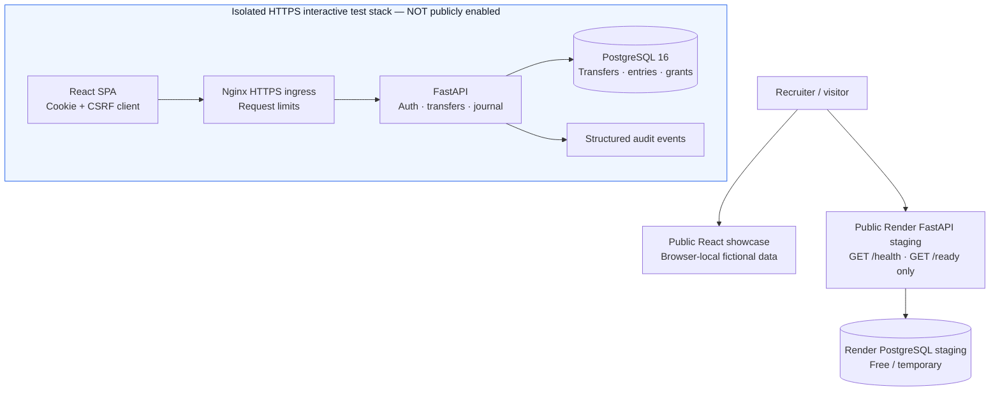

# LedgerFlow
### PostgreSQL-backed financial ledger simulation · Full-stack engineering portfolio

[](https://github.com/olabs123-hue/LedgerFlow./actions/workflows/ci.yml)
[](https://github.com/olabs123-hue/LedgerFlow./actions/workflows/security.yml)
[](https://github.com/olabs123-hue/LedgerFlow./actions/workflows/interactive-e2e.yml)
[](https://github.com/olabs123-hue/LedgerFlow./actions/workflows/phase3-reliability.yml)

**[Explore the live UI showcase](https://ledgerflow-showcase-olabs123.onrender.com)** · **[Check API health](https://ledgerflow-api-staging-t1yt.onrender.com/health)** · **[Architecture](docs/ARCHITECTURE.md)** · **[Benchmark results](PHASE3_REPORT.md)**

> **Fictional balances only.** LedgerFlow is a portfolio prototype, not a bank, payment processor, or regulated financial service. No real funds are moved.
>
> **What is live?** The public React showcase uses browser-local example data and never calls a financial API. The separate public FastAPI/PostgreSQL staging server is **read-only** and exposes only `GET /health` and `GET /ready`. The cookie-authenticated, transactional full-stack experience is **built and verified in isolated HTTPS CI**, but is **not** publicly open for registration or transfers.

## Why build it?

LedgerFlow explores a familiar systems challenge: **how can a transfer survive concurrent requests, retries and process restarts without corrupting balances?** A transfer moves fictional integer cents between accounts using a single PostgreSQL transaction, deterministic account-row locking, one idempotency key per sender, and matched debit/credit entries.

| Engineering problem | Implemented approach | Evidence |
| --- | --- | --- |
| Double spends and lost updates | PostgreSQL row locks on accounts, acquired in ascending ID order | [Concurrent integration tests](backend/tests/test_pg_integration.py) |
| Retries after uncertain outcomes | Sender-scoped idempotency keys and request-body hashes | [PostgreSQL tests](backend/tests/test_pg_integration.py) · [Crash recovery](scripts/phase3_recovery.py) |
| Ledger correctness | Integer-cent amounts, balance constraints and two entries per transfer | [Schema migrations](backend/migrations/versions/) · [Reconciliation tool](backend/demo_operations.py) |
| Authentication | Argon2 password hashing, short-lived JWTs, token revocation and login throttling | [Auth and cookie tests](backend/tests/test_browser_sessions.py) |
| Safer browser session | Same-origin `__Host-` Secure/HttpOnly/SameSite cookie, server-side revocation and CSRF proof | [HTTPS Chromium E2E](frontend/interactive-tests/cookie.spec.ts) |
| Operational recovery | Health/readiness, Docker restart test, PostgreSQL dump/restore verification | [Phase 3 report](PHASE3_REPORT.md) |
| Controlled release | Public API read-only by default; separate CI-only interactive topology with edge limits | [Release gates](PHASE2_RELEASE.md) · [Live safety checks](scripts/verify_staging_api.py) |

## Architecture

The overview below distinguishes the **currently public components** from the **interactive stack tested in CI**.



See [architecture details, trust boundaries and transfer sequence](docs/ARCHITECTURE.md).

## Technology

- **Backend:** Python 3.13, FastAPI, SQLAlchemy, Pydantic, Alembic, Argon2, PyJWT.
- **Data:** PostgreSQL 16 (transactional row locking, uniqueness and CHECK constraints).
- **Frontend:** React 18, TypeScript, Vite; browser-only showcase and separate opt-in cookie-based client.
- **Operations:** Docker Compose, a multi-stage Docker build, GitHub Actions, Playwright, Render staging.
- **Security:** Same-origin session prototype, CSRF and Origin checks, DB-backed login throttling, structured audit events, dependency/static scans.

## Experience the demo

**Public preview:** [Open the LedgerFlow showcase](https://ledgerflow-showcase-olabs123.onrender.com). Try the simulated transfer form. This deliberately updates local React state only, so refreshing resets the preview.

**Staging API:** [Health](https://ledgerflow-api-staging-t1yt.onrender.com/health) · [PostgreSQL readiness](https://ledgerflow-api-staging-t1yt.onrender.com/ready). Authentication, registration, balance queries and transfers are **not** accessible publicly.

**Full interactive demo:** The CI suite builds the React app and FastAPI into a single origin, provisions fictional invited users on disposable PostgreSQL, runs real Chromium login → transfer → logout flows, verifies ingress rate limiting, and restores a DB backup. It is a test environment, **not a public URL or a permanent hosted service**.

## Run the development stack locally

Prerequisites: Docker Engine / Docker Desktop with Compose, a local checkout, and available localhost ports 5173, 8000 and 5433.

```bash
git clone https://github.com/olabs123-hue/LedgerFlow..git
cd LedgerFlow.
cp .env.example .env
# Set JWT_SECRET in .env to a new, cryptographically random 32+ character value.
docker compose up --build
```

Open http://localhost:5173 for the legacy development UI and http://localhost:8000/docs for the development API. In this **local-only simulation** you can create two users, sign in and transfer fictional credits; `DEMO_MODE=true` enables local demo funding. Never expose those settings on an internet-facing host.

**Database migrations:** Production-style environments use `cd backend && alembic upgrade head`. Do not run migrations against an existing populated database without a verified backup and migration plan. Revision `0006_funding_grants` records auditable fictional funding grants.

**Run automated tests:**

```bash
cd backend
python -m pip install -r requirements.txt
PYTHONPATH=. pytest -q tests/test_api.py tests/test_sessions.py tests/test_browser_sessions.py tests/test_auth_peer_limit.py tests/test_audit.py tests/test_provisioning.py tests/test_funding_grants.py tests/test_production_guardrails.py
```

The PostgreSQL-only, concurrency and interactive HTTPS tests are run against disposable databases by [GitHub Actions](.github/workflows/ci.yml) and [Controlled Interactive Demo E2E](.github/workflows/interactive-e2e.yml); they require specialized environments and **must not** run against the live staging database.

### Controlled demo and offline fictional credits

A trusted operator can provision invited demo accounts and record a simulated opening grant using the [Phase 2 runbook](PHASE2_RELEASE.md). There is **no public provisioning or funding endpoint** in the production policy. See [`provision_demo_account.py`](backend/provision_demo_account.py) and [`demo_operations.py`](backend/demo_operations.py). Do not submit real credentials or bank details.

## Performance and reliability: measured, not estimated

GitHub Actions measured transfers using **FastAPI in-process TestClient** with runner-local PostgreSQL. For each concurrency level there were 100 actual persisted simulated transfers, no request errors, 10 successful idempotent replays and 200 balanced journal entries.

| Workers | Transfers/s | p95 latency | p99 latency |
| ---: | ---: | ---: | ---: |
| 1 | 62.15 | 41.93 ms | 116.22 ms |
| 4 | **82.29** | 68.17 ms | 83.93 ms |
| 8 | 49.81 | 431.99 ms | 516.98 ms |

The 4-worker configuration had the highest throughput in this **single CI comparison**. At 8 workers, contention raised latency. **These are not deployed-service throughput, internet load-test or production SLO measurements.** Method, one-run variability, raw artifact retention and recovery results: [Phase 3 report](PHASE3_REPORT.md).

A separate fault-injection test kills the FastAPI process and restarts PostgreSQL. Replaying the previously committed transfer returns the original transaction without duplicating debits. See the [reliability workflow](.github/workflows/phase3-reliability.yml).

## Project layout

```text
backend/
  app/main.py                  API, transfer logic and ORM
  app/audit.py                 Allowlisted, privacy-minimizing audit events
  migrations/                 Alembic SQL schema history
  tests/                      API, cookies, security, PostgreSQL integration
  benchmark_transfers.py      Bounded reproducible local benchmark
  provision_demo_account.py   Operator-only invited account provisioning
  demo_operations.py          Fictional grants and reconciliation
frontend/
  src/Showcase.tsx             Public, browser-only portfolio showcase
  src/CookieApp.tsx            Opt-in same-origin, cookie-based app
  src/App.tsx                  Local development client only
  interactive-tests/          Chromium HTTPS desktop/mobile journeys
ci/                           Isolated HTTPS ingress test configuration
scripts/                      Crash/restart and live-safety probes
Dockerfile.interactive        Same-origin React/FastAPI image for CI release rehearsal
docs/ARCHITECTURE.md          Component and transfer sequence diagrams
PHASE2_RELEASE.md             Interactive release requirements
PHASE3_REPORT.md              Recorded benchmarks and failure-recovery evidence
SECURITY_AUDIT.md             Scoped audit and outstanding risks
```

## Security scope and release status

Security scanners and integration tests have passed, but no professional penetration-test certification is claimed. **The public interactive service has not been launched.** Before enabling write operations, verify real hosting-edge client/IP rate controls and forwarded-header trust, durable PostgreSQL backups and recovery, invited-user provisioning, session-lifecycle checks and deployment alerts.

Read [the security audit](SECURITY_AUDIT.md) and [the deployment checklist](PHASE2_RELEASE.md). The existing **free Render PostgreSQL database is scheduled to expire on 21 December 2026**; the portfolio must not depend on it for permanent customer-like data.

## What this demonstrates

Transactional API design · idempotency under retries · deadlock-aware row locking · double-entry journals · secure-by-design browser sessions · PostgreSQL integrity · CI/CD · browser testing · bounded performance measurement · restart/recovery engineering.

**All payments, amounts and balances in this repository are fictional.**
