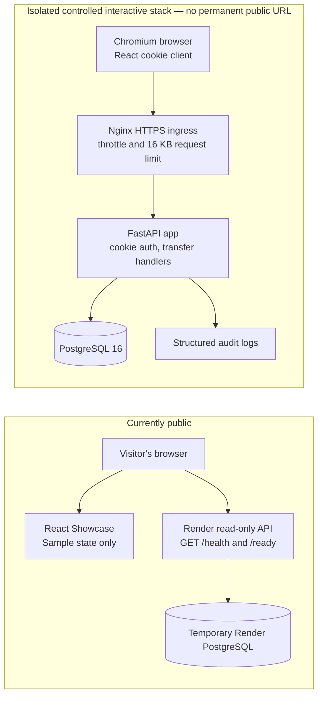
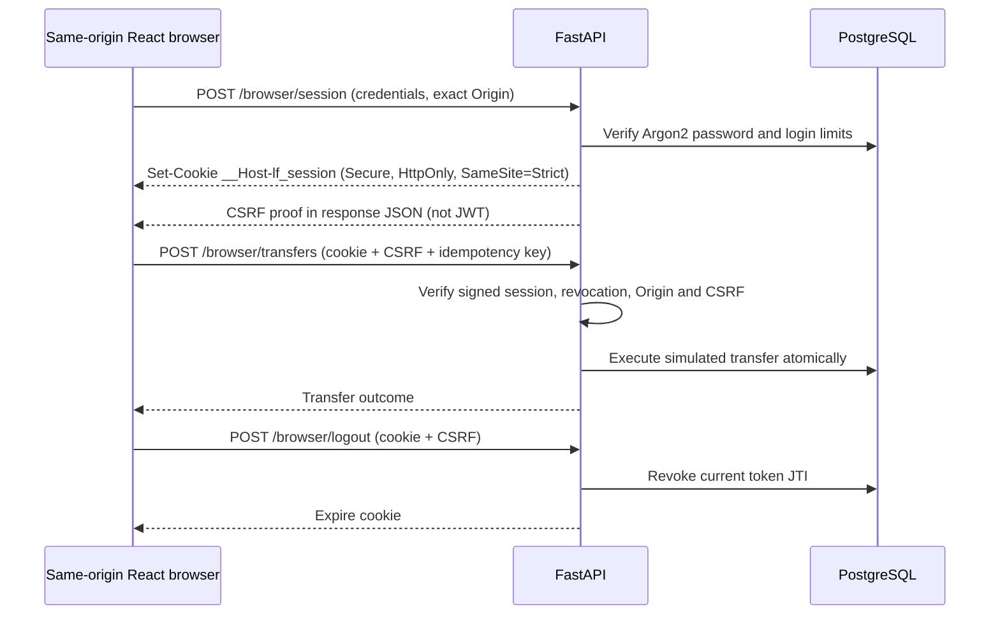
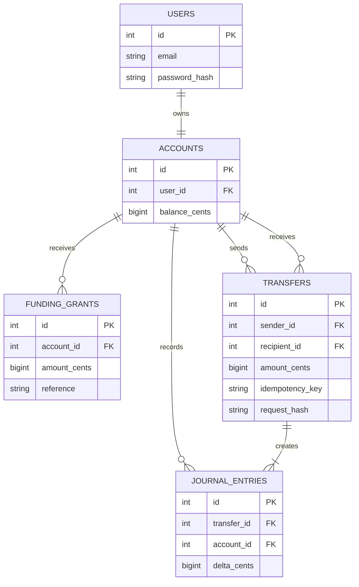

# LedgerFlow architecture and engineering decisions

**Status:** Portfolio-grade fictional financial ledger. This document describes the actual implementation and distinguishes public deployment from isolated CI verification.

## Deployment boundaries



- The **public showcase** uses `Showcase.tsx`, illustrative financial data and client-side state; it **does not** call FastAPI.
- The **Render staging API** serves only `/health` and `/ready` with `APP_ENV=production` and `PUBLIC_API_READONLY=true`. All registration, login, account, transfers, docs and interactive static routes are blocked.
- The **controlled interactive demo** is built into `Dockerfile.interactive` and tested through disposable TLS proxy + database using `docker-compose.interactive-ci.yml`. It is **not** currently deployed publicly.

## Transfer sequence and transaction boundary

```mermaid
sequenceDiagram
    participant C as Authenticated client
    participant API as FastAPI
    participant DB as PostgreSQL
    C->>API: POST /transfers + Idempotency-Key
    API->>DB: Find sender and recipient account IDs
    API->>DB: BEGIN; SELECT both accounts FOR UPDATE ordered by ID
    DB-->>API: Locked accounts
    API->>DB: Lookup sender-scoped idempotency key
    alt Previously committed same request
      DB-->>API: Existing transfer
      API-->>C: 200 replayed=true, original ID
    else Key reused with different payload
      API-->>C: 409 conflict
    else New valid transfer
      API->>DB: Check sufficient fictional balance
      API->>DB: Update both account balances
      API->>DB: INSERT Transfer + two Journal Entries
      API->>DB: COMMIT
      API-->>C: 200 replayed=false, new transfer ID
    end
```

All money-like values are stored as **integer cents**. The sender and recipient account rows are locked in deterministic increasing-ID order to avoid opposing-transfer deadlocks. The transfer record is unique per `(sender_id, idempotency_key)` and stores a request hash. When the same request is retried, the existing transfer is returned, not duplicated.

Each transfer writes two journal entries: **negative amount** for the sender and **positive amount** for the recipient. The transaction commits both changes together. Schema CHECK constraints enforce nonnegative account balances, positive transfers, distinct sender/recipient accounts and nonzero journal entries. The reconciliation command additionally checks the two-entry sum and balance calculations. **Append-only database permissions and independent journal tamper protection remain further hardening work**, not claimed completed.

## Identity and access



The local development UI (`App.tsx`) is a separate legacy bearer-token flow and **must not** be marketed as hardened browser authentication. Public interactive production routing refuses legacy bearer routes, registration, funding and docs and exposes only approved `/browser/` routes plus health, readiness and optional same-origin assets.

## Schema relationships



Additional operational tables: `login_attempts` (failed attempts keyed by email digest), `auth_peer_buckets` (coarse shared peer throttle) and `revoked_tokens` (revoked JWT identifiers). All tables are migrated by Alembic, through revision `0006_funding_grants`.

## Fault tolerance and observability

- `GET /health` checks application liveness; `GET /ready` runs a sanitized `SELECT 1` against PostgreSQL.
- Structured allowlisted audit events record operation category, status, request ID and elapsed milliseconds without intentionally storing passwords, bearer tokens, email identities, query strings or client IPs **in those audit events**. Web-server access logs follow separate policies.
- PostgreSQL idempotency is durable across process restarts. An isolated Docker test sends `SIGKILL` to the API and restarts PostgreSQL, then retries an already committed transfer to verify there is no second debit.
- A disposable CI dump/restore test checks restored funding grants, balances and journal conservation. **It is not a live provider backup policy.**
- GitHub Actions checks the public read-only service on a scheduled six-hour cadence (best effort; not an SLA or pager).

## Benchmark scope

100 simulated transfers each at 1, 4 and 8 threads, against runner-local PostgreSQL using in-process FastAPI TestClient. This measures backend behavior under a small single-hot-account workload, **not** public HTTPS throughput. Details and source logs are in [`PHASE3_REPORT.md`](../PHASE3_REPORT.md).

## Key technical tradeoffs

| Decision | Benefit | Cost / limitation |
| --- | --- | --- |
| Canonical sorted row locks | Avoids opposing lock-order deadlocks | Single hot account limits scaling |
| Request-scoped idempotency | Safe retries after uncertain results | Requires key retention and uniqueness |
| Integer cents + balanced entries | Predictable arithmetic and auditability | Integrity still needs reconciliation and DB privileges |
| Signed HttpOnly same-origin cookie | Avoids JavaScript-readable bearer token in hardened client | Requires CSRF/Origin checks and secure session lifecycle |
| Read-only public staging | Limits exposure of risky financial operations | Recruiters cannot transact against hosted API |
| GitHub-hosted in-process benchmark | Reproducible baseline with database correctness | Not a network load test or long-term capacity guarantee |

## Next safe release steps

See [`PHASE2_RELEASE.md`](../PHASE2_RELEASE.md) and [`SECURITY_AUDIT.md`](../SECURITY_AUDIT.md). In particular, verify real edge attribution/rate limits, upgrade the expiring free database to a durable tier with tested retention, configure alerting, secure invitation handling, and complete live-environment testing **before** enabling public financial writes.
